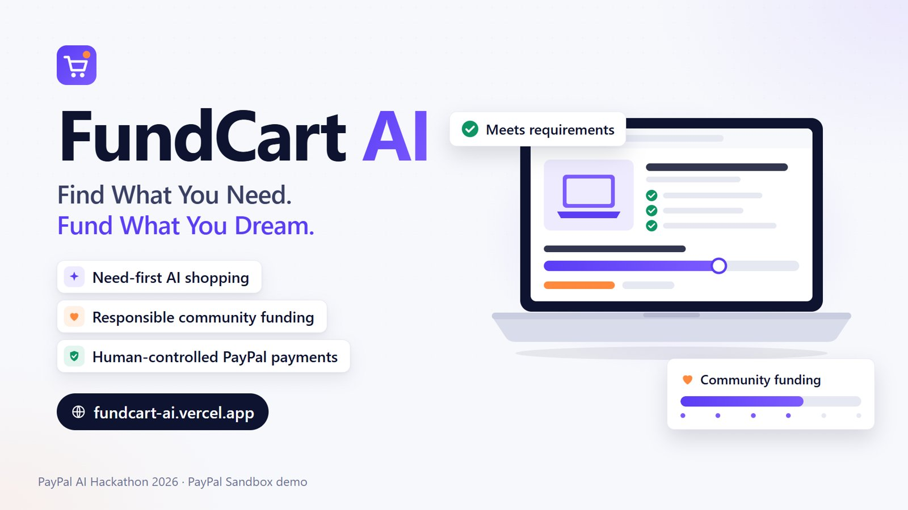
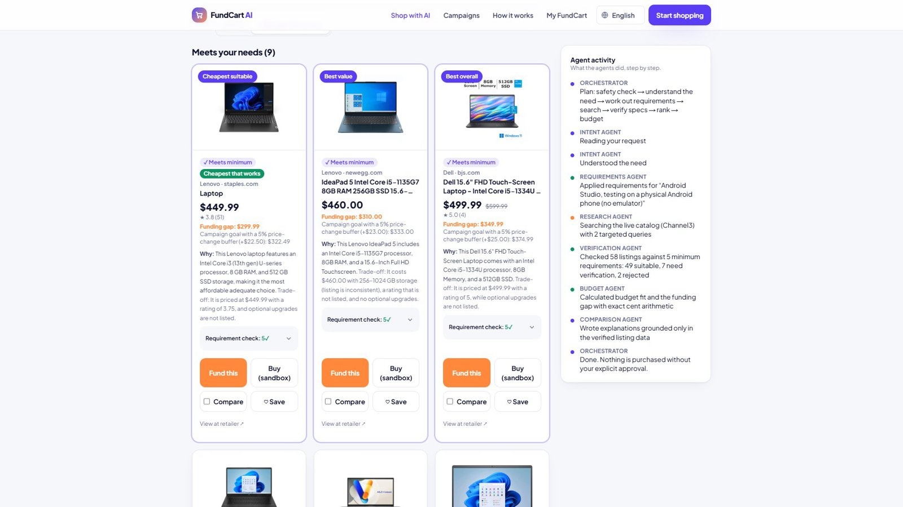
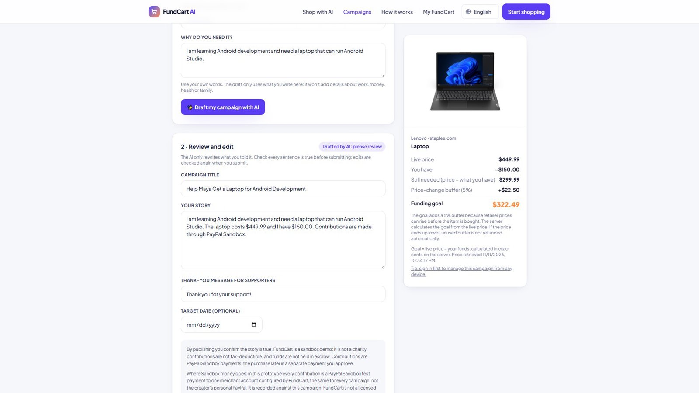
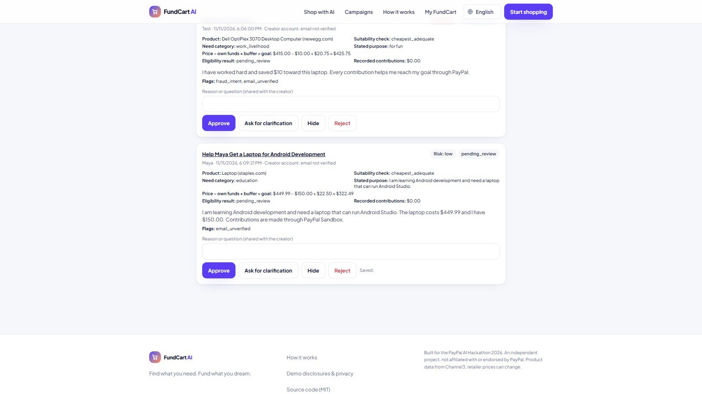
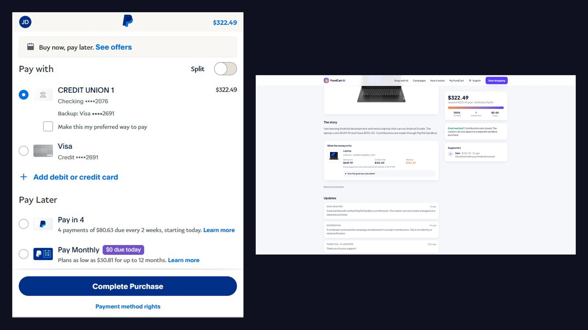
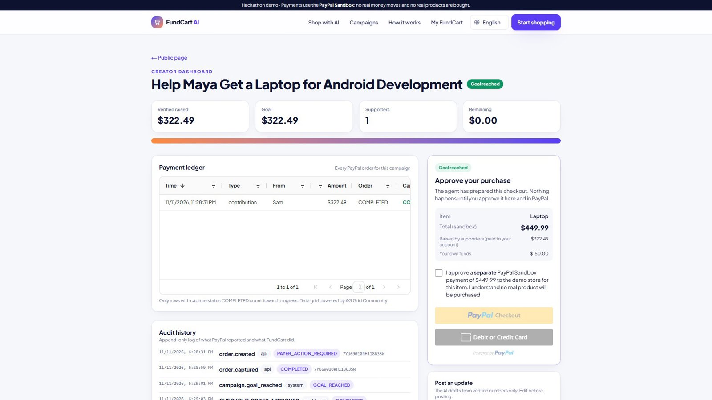
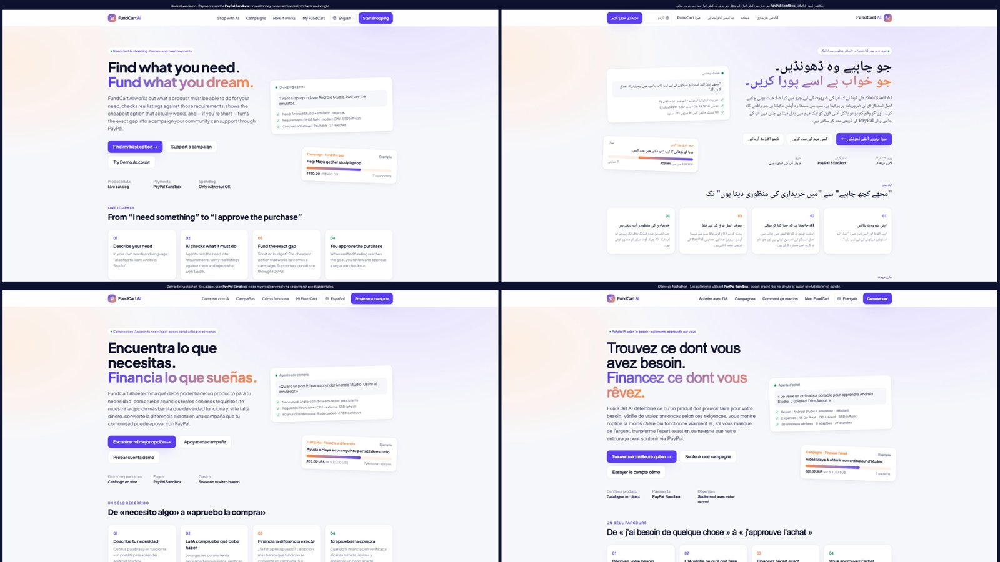
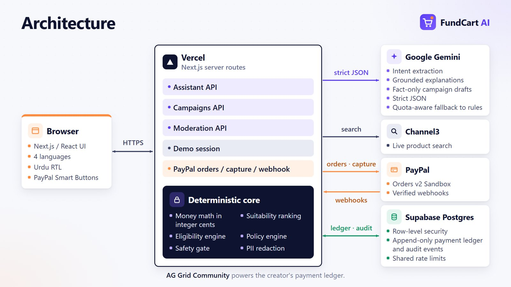

# FundCart AI — Find what you need. Fund what you dream.



**FundCart AI is where smart shopping meets community support.** Describe what you need in your own words. FundCart's AI finds real products that fit your purpose and budget and shows exactly how far your money goes. If the right item costs more than you have, FundCart turns the gap into a campaign your friends and family can support through **PayPal**. When the goal is reached, you approve the purchase yourself.

Built for the **PayPal AI Hackathon 2026**.

- **Try it:** https://fundcart-ai.vercel.app
- **Demo video (2:49):** https://youtu.be/VIDDhd0WFvY
- **Explore without signing up:** press **Try Demo Account** on the home page (a read-only sample dashboard)

> **Sandbox demo.** Every payment uses the PayPal Sandbox. No real money moves and no real product is bought. FundCart AI is not a charity, bank or escrow service, and it is not affiliated with PayPal.

## The problem

People often know *roughly* what they need ("a laptop for university"), but not which product fits their purpose and budget. When the right item costs more than they have, asking for help usually means a vague message and a bank transfer, with no clear goal and no visible progress.

## How it works

Meet Maya. She needs a laptop for university, wants to spend under $700, and has $200 saved.

1. **She asks in plain words.** FundCart's AI understands her purpose and budget and searches a live product catalog.
2. **She compares real options.** Every result has a live price and retailer, an AI explanation of why it fits, and the exact funding gap. The top pick is a $550 laptop, which leaves a $350 gap.
3. **She clicks "Fund this".** The goal is calculated on the server from the live price: price − what she has + a 5% price-change buffer, each part shown before she commits. The AI drafts a story using only what Maya wrote; she edits it, signs in, and submits. Campaigns from accounts without a verified email are checked by a moderator before they can accept support.
4. **Supporters contribute through PayPal.** Progress moves only when PayPal confirms a payment for the exact amount.
5. **She approves the purchase.** Once the goal is reached, Maya ticks an explicit approval and pays the store in a **separate** PayPal checkout. Nothing is ever bought automatically.

Shoppers who can already afford an item can also check out directly, with the same explicit approval.

## Screenshots

| | |
|---|---|
|  Requirements checked listing by listing; the cheapest laptop that qualifies comes first |  Price − savings + 5% price-change buffer = goal, calculated on the server |
|  Moderator queue with purpose, risk, flags and goal breakdown |  Supporter approves in PayPal; the contribution counts after a verified capture |
|  Verified payment ledger and the separate, human-approved purchase |  Four languages, including right-to-left Urdu |

## Features

| | |
|---|---|
| **Need-first AI shopping** | Describe the need ("a laptop to learn Android Studio"); the agents turn it into requirements (official sources where they exist), verify real listings against them, reject wrong products (books, toys, software) and unconfirmed specs, and rank by best fit or the cheapest option that works |
| **Conversation memory** | Follow-ups keep earlier requirements: "cheaper", "not HP", "I need 16GB RAM", "compare the first and third", "forget the budget" |
| **Four languages** | English, Urdu (right-to-left), Spanish and French across the whole site; the assistant also understands Roman Urdu and mixed English/Urdu |
| **Budget planning** | Exact funding gap for every product, calculated on the server |
| **AI-assisted campaigns** | Campaign story, thank-you note and progress updates drafted by AI from the creator's own words only; sentences claiming things the creator never said (work, hardship, health, family, verification) are removed |
| **Publication security** | Shopping is open to everyone; publishing a campaign that asks for money needs a signed-in account and passes a separate eligibility check: stated purpose vs need category, stated intent to deceive, invented story claims, product-suitability evidence, duplicates and velocity. Anything uncertain waits for a moderator |
| **One-click demo** | "Try Demo Account" opens a read-only creator dashboard with sample data (progress, payment ledger, campaign controls) without any password and without touching real records |
| **PayPal contributions** | PayPal Checkout for supporters; progress counts only PayPal-confirmed payments; overfunding is rejected; optional private email receipt after PayPal verifies the payment |
| **Creator accounts & dashboard** | Optional sign-in to manage campaigns from any device; every PayPal payment with its status and reference, plus an audit history |
| **Human-approved purchase** | A separate PayPal checkout that the creator explicitly approves; the live price is re-checked first and a price rise pauses the purchase |
| **29 shopping intents** | Exact items, compatibility, problems, gifts, comparisons, deals, kits, contradictions, support and donor questions and more, each with its own behaviour; when data is missing (delivery dates, trends, certifications, order history, images) the assistant says so instead of inventing it |
| **Safety engine** | Rules run before any AI call and check the planned action as well as the message: prompt injection in five languages, fake admin claims, other people's data, restricted items, return fraud, covert tracking, self-harm. Cautions keep normal shopping going |
| **Campaign trust** | Cheapest-suitable-item rule, an itemised goal (price + buffer − own money), content review with personal-data removal, duplicate and velocity checks, public reports, a moderator queue, and an "unverified" label until a real verification provider exists |
| **Country policy** | Fundraising, cross-border contributions and campaign categories are set per country in versioned configuration. Real-money fundraising is off everywhere; some countries are shopping-only |

## AI agents

FundCart's assistant is a team of cooperating agents powered by **Google Gemini**:

- **Intent Agent:** turns a request in any of five languages into a validated shopping brief: the product, what it must do, skill level, budget (amounts like "1.5 lac" or "50 hazar" are parsed by code; an amount without a clear currency, such as "budget 5k", is asked about rather than assumed to be dollars), exclusions, and follow-up references.
- **Requirements Agent:** maps needs such as Android development, video editing, gaming or study to minimum, best-value and optional-upgrade specs, with official sources where available (for example Google's Android Studio requirements).
- **Research Agent:** runs targeted, category-filtered searches on **Channel3's** live catalog and widens them only when too few suitable products fit the budget.
- **Verification Agent:** reads RAM, storage, processor, graphics and OS from each listing, flags inconsistent listings and implausible prices, and never treats a missing spec as met.
- **Comparison Agent:** ranks verified products (best fit or cheapest that works) and explains them using only the retrieved product data.
- **Budget Agent:** calculates funding gaps with exact integer-cent arithmetic.
- **Campaign Assistant:** drafts campaign copy from verified numbers only, with no charity claims and no invented urgency.
- **Payment Agent:** prepares the checkout summary. It **cannot** pay: payment requires explicit confirmation plus approval inside PayPal.

The AI never sets prices or totals. Third-party product text is treated as untrusted data. If the AI service is unavailable, the app uses clearly labelled rule-based logic.

## PayPal integration (Sandbox)

- **Orders API:** the server creates every order with an amount it calculates itself (the browser cannot change it), using an idempotency key.
- **JavaScript SDK (Smart Buttons):** buyers approve each payment inside PayPal. The server then captures the payment and confirms it with PayPal: status completed, exact amount, correct currency.
- **Webhooks:** PayPal's payment notifications are signature-verified, deduplicated and matched to their orders. A payment is never counted twice. Refunds and reversals reduce the campaign total, including partial refunds.
- **Separation of money flows:** in this prototype every Sandbox contribution is paid to one merchant account configured by FundCart (the same for every campaign, not the creator's personal PayPal) and recorded against the chosen campaign; the purchase is a separate checkout to the demo store. See [Campaign publication](docs/CAMPAIGN_PUBLICATION.md#where-sandbox-money-goes).

## Architecture



```
Browser (Next.js 16 App Router, React 19, Tailwind 4)
  │  live stream of agent steps
  ▼
Server route handlers ─────────────────────► Google Gemini       — understanding, explanations, campaign copy
  │   ├─ Agent orchestrator ───────────────► Channel3 API        — real products & live prices
  │   ├─ Money module (integer cents)
  │   ├─ PayPal module ────────────────────► PayPal Orders API   — create / capture / confirm
  │   └─ Webhook handler (verified) ◄──────── PayPal webhooks
  ▼
Supabase Postgres (row-level security on; server-only access)
```

More detail: [Architecture](docs/ARCHITECTURE.md) · [AI intelligence](docs/AI_INTELLIGENCE.md) · [Shopping intents](docs/SHOPPING_INTENTS.md) · [Product suitability](docs/PRODUCT_SUITABILITY.md) · [Multilingual](docs/MULTILINGUAL.md) · [Testing](docs/TESTING.md) · [Known limitations](docs/KNOWN_LIMITATIONS.md) · [AI agents](docs/AI_AGENTS.md) · [PayPal integration](docs/PAYPAL_INTEGRATION.md) · [PayPal Sandbox](docs/PAYPAL_SANDBOX.md) · [Sponsor integrations](docs/SPONSOR_INTEGRATIONS.md) · [Deployment](docs/DEPLOYMENT.md) · [Demo script](docs/DEMO_SCRIPT.md) · [Test evidence](docs/TEST_EVIDENCE.md)

## Built with

PayPal Orders API · PayPal JavaScript SDK · PayPal Webhooks · Google Gemini · Channel3 · AG Grid Community · Next.js · React · TypeScript · Tailwind CSS · Supabase (PostgreSQL) · Vercel

**Sponsor tools used:** **Channel3** (live product search) and **AG Grid Community** (the creator's payment ledger).

## Security

- All secrets stay on the server; the browser only receives the public PayPal client ID.
- The database uses row-level security with no public policies, and only server code can access it.
- Amounts and goals are calculated on the server; the client cannot set them.
- Publishing a campaign requires a signed-in account (Supabase Auth), checked on the server; guests can shop, compare and prepare a draft that is kept in their browser through sign-in. Campaign management and purchase approval are checked on the server against the campaign owner; older guest campaigns move into an account only from the browser that holds their signed guest cookie.
- A deterministic eligibility engine, separate from shopping, decides whether a campaign goes live, needs clarification or waits for a moderator. The AI can never approve a campaign, verify anyone or change a payment. See [Campaign publication](docs/CAMPAIGN_PUBLICATION.md).
- The demo account is a signed, short-lived, read-only session over fixed sample data: no shared password, no database access, no moderator rights.
- A safety check runs before any search (prompt injection, self-harm, restricted items, covert surveillance, counterfeits); card numbers are removed from messages before they are stored or sent to the AI.
- Supporter emails for receipts are collected only when receipt emails are enabled, stored privately and never shown publicly.
- Rate limits are shared across server instances (Postgres counters with hashed keys) and apply per IP and per visitor, with a daily AI allowance so automated traffic cannot drain the model quota.
- Payments: $5 minimum (card-testing defence), contribution velocity limits, duplicate-order reuse, hidden bot fields, idempotent capture, deduplicated webhooks and decline-spike alerts.
- Moderation and verification state can only be changed by moderators (role from the database) or by an approved verification process, never by chat or request fields.
- See [Security](docs/SECURITY.md), [Anti-fraud](docs/ANTI_FRAUD.md), [Campaign publication](docs/CAMPAIGN_PUBLICATION.md) and [Policy engine](docs/POLICY_ENGINE.md).

## Limitations

- **Sandbox only:** no real money moves and no real products are purchased.
- **Not escrow or charity:** FundCart AI does not hold funds and is not a charity or bank.
- **Single recipient:** one authorized Sandbox account currently receives contributions on behalf of every campaign creator. A production version would let each creator connect their own PayPal account.
- **Refunds:** only the recipient can issue a refund. FundCart's handling of refund notifications is built but has not yet been exercised with a recipient-issued refund.
- **Accounts:** email addresses are not verified in this demo build (shown as "Email not verified"), so every new campaign waits for a moderator before it can accept support; provider-verified sign-up switches on once a custom email provider is configured. Password-reset emails need that provider to arrive reliably.
- **Verification:** no identity or need-verification provider is connected, so every campaign is labelled unverified. Country rules are research summaries, not legal advice.
- **Receipts:** the receipt email integration is built but switched off until a transactional email provider is configured. While it is off, the receipt email field is hidden and no email address is collected; receipts are still available on the receipt page.
- **Spec checks** depend on what retailers list; unconfirmed specs are labelled "check before buying". Translations are machine-assisted.
- Prices come from live retailer data and may change.

## What's next

Verified email and creator identity, a licensed payment partner with payment to the retailer, real merchant fulfilment, more countries after local legal review, university and NGO pilots, broader product data, and an external security review before any real money is involved.

## Documentation

| Topic | Document |
|---|---|
| System design | [Architecture](docs/ARCHITECTURE.md) · [AI intelligence](docs/AI_INTELLIGENCE.md) · [AI agents](docs/AI_AGENTS.md) |
| Shopping | [29 shopping intents](docs/SHOPPING_INTENTS.md) · [Product suitability](docs/PRODUCT_SUITABILITY.md) |
| Trust | [Campaign publication and moderation](docs/CAMPAIGN_PUBLICATION.md) · [Security](docs/SECURITY.md) · [Anti-fraud](docs/ANTI_FRAUD.md) · [Policy engine](docs/POLICY_ENGINE.md) |
| Payments | [PayPal integration](docs/PAYPAL_INTEGRATION.md) · [PayPal Sandbox](docs/PAYPAL_SANDBOX.md) |
| Languages | [Multilingual](docs/MULTILINGUAL.md) |
| Quality | [Testing](docs/TESTING.md) · [Test evidence](docs/TEST_EVIDENCE.md) · [Known limitations](docs/KNOWN_LIMITATIONS.md) |
| Running it | [Deployment and environment variables](docs/DEPLOYMENT.md) |

## Team

Built for the PayPal AI Hackathon 2026 by **Talal Khawaja**, **Aqeela Urooj** and **Safa Kamran**.

## Run locally

Requirements: Node.js 20+, a PayPal Developer account (Sandbox), a Channel3 API key and a Supabase project. A Gemini key is optional. Full setup: [`docs/DEPLOYMENT.md`](docs/DEPLOYMENT.md).

```bash
git clone https://github.com/kmt9967/fundcart-ai && cd fundcart-ai
npm install
cp .env.example .env.local      # fill in the values
npm run db:migrate              # applies db/migrations/*.sql
npm run dev                     # http://localhost:3000
```

Checks:

```bash
npm run typecheck && npm run lint
npm test             # unit tests
npm run test:e2e     # browser flows using PayPal Sandbox test accounts
```

## License

MIT, see [LICENSE](LICENSE).
