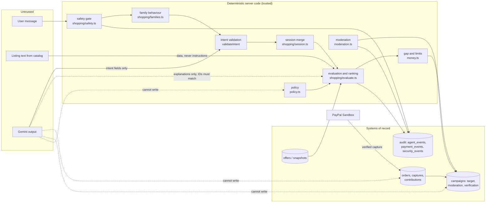

# Architecture

FundCart AI is a Next.js (App Router) application with a server-only data layer. Every decision
that involves money, eligibility, permissions or safety is made by deterministic server code. The
AI model (Gemini) interprets requests and writes explanations; it never sets a price, a total, a
payment state, a verification status or a policy outcome.

## Code map

```
src/
  app/
    page.tsx                     landing
    assistant/                   AI shopping assistant (streams the agent timeline)
    campaigns/, campaigns/new/   campaign list and AI-assisted builder (policy-gated)
    c/[slug]/                    public campaign, contribution, report form, goal formula
    c/[slug]/manage/             creator dashboard: ledger, audit log, AI updates, purchase approval
    admin/moderation/            moderator queue (role checked on the server)
    checkout/[externalId]/       direct human-approved Sandbox checkout
    receipt/[orderId]/           receipt + event history (payer/owner only)
    account/, me/, how-it-works/, disclosures/
    api/
      assistant/                 POST → NDJSON agent events + result
      campaigns/                 create (policy, moderation, gap formula, cheapest-adequate rule)
      campaigns/[slug]/          owner actions; campaigns/[slug]/report: public reports
      campaigns/draft/           AI campaign draft from verified facts only
      admin/moderation/          moderator decisions (approve / hide / reject)
      paypal/orders/, paypal/orders/[orderId]/capture/, paypal/webhook/
      auth/, wishlist/, diagnostics/ai/, cron/keepalive/
  lib/
    money.ts            integer-cent arithmetic, campaignGap(), contribution limits
    policy.ts           country policy engine (trusted configuration)
    moderation.ts       campaign content review, PII scrub, fingerprints
    ratelimit.ts        shared Postgres rate limiter (hashed buckets) + per-instance fallback
    security-events.ts  append-only abuse/security log
    moderators.ts       moderator role check and queue
    channel3.ts         catalog search, normalisation (untrusted data), snapshots, live re-check
    paypal.ts           OAuth, Orders v2, refunds, webhook signature verification
    payments.ts         capture-and-record state machine, idempotency, goal detection, decline alerts
    receipts.ts         receipt records; email only when a provider is configured
    auth.ts, identity.ts  accounts (Supabase Auth) and signed guest identity
    ai/llm.ts           Gemini REST, JSON schemas, quota-aware retries, diagnostics
    shopping/           need-first pipeline (see below)
db/migrations/          SQL schema (RLS on, no public policies, append-only triggers)
tests/unit, tests/agent, tests/e2e
```

## Shopping pipeline (one turn)

1. **Rate limits and AI allowance** (code): shared per-IP limits; a per-visitor and global daily
   allowance for model-backed turns. Beyond it the assistant runs in rule-based mode.
2. **Policy gate** (code): the request country comes from the hosting edge header; the country
   policy decides whether a funding option may be offered.
3. **Safety gate** (rules): personal data is redacted first; blocking flags short-circuit the turn
   with no product search; notices (medical, allergen, spending pressure, sensitive purchase) add
   cautions; support and donor questions are answered from policy text.
4. **Family behaviour** (code, `shopping/families.ts`): detects the 29 intent families from the
   text and decides whether to ask first (compatibility without a model number, safety-critical
   vehicle parts), whether to ask alongside results (size), kits, problem → solution types,
   comparisons, substitutes, contradictions and honest capability limits.
5. **Intent** (model, schema-validated; rules as fallback and cross-check).
6. **Session merge** (code): constraints persist across turns ("cheaper", "not HP", "the second one").
7. **Requirements** (code): official vendor requirements and stated constraints.
8. **Retrieval** (code → Channel3): at most three targeted catalog calls.
9. **Evaluation and ranking** (code): every listing is checked against every minimum requirement;
   best fit or cheapest adequate.
10. **Budget and gap** (code): integer cents only.
11. **Explanations** (model): written only from the verified fields of the shown products.

## The nine objects and the trust boundary

The team's research proposes nine objects, separated by who may write them. FundCart implements
the same boundaries:

| Object | Holds | Written by | Where |
|---|---|---|---|
| intent | families, category, use case, constraints, budget text, references, language | Model, then strict validation (unknown fields dropped) | `shopping/pipeline.ts` `validateIntent`, `shopping/types.ts` |
| session | persistent constraints, exclusions, budget, shown results | Code merges each turn | `shopping/session.ts` (`ai_sessions.intent`, owner-checked) |
| context | country, locale, signed identity, account role | Edge header, cookies, database | `policy.ts` `requestCountry`, `identity.ts`, `auth.ts` |
| policy | per-country gates, need categories, disclosures, limits | Versioned configuration in code | `policy.ts` (`POLICY_VERSION`) |
| offers | catalog listings with price, merchant, fetch time | Channel3 data, normalised as untrusted | `channel3.ts`, `product_snapshots` |
| cart / order | PayPal orders, captures, amounts, idempotency | Code + PayPal | `payments.ts`, `payment_orders`, `contributions` |
| funding | gap formula, target, moderation and verification state | Code at creation and before purchase; moderators | `api/campaigns`, `money.ts`, `campaigns` columns |
| safety | flags, notices, injection signals | Rules (model hint can only add caution) | `shopping/safety.ts`, `ai_sessions.safety` |
| audit | agent steps, payment events, security events, policy version | System, append-only | `agent_events`, `payment_events`, `security_events` |



The model may write: intent fields (validated) and explanation text grounded in `<product_data>`.
It may not write: prices, totals, stock, delivery, discounts, payment state, campaign targets,
moderation or verification status, roles, country policy, refunds or shipping confirmation.

## Data model

`profiles` (role, email_verified), `product_snapshots`, `search_cache`, `ai_sessions` (redacted
prompt, safety flags, policy version), `agent_events` (append-only), `wishlist_items`, `campaigns`
(country, need category, ranking mode, gap formula, buffer, moderation status and reasons,
verification status, live price re-check, policy version), `campaign_updates`, `campaign_reports`,
`payment_orders` (payer country, policy version), `contributions` (verified only), `payment_events`
(append-only), `purchase_approvals`, `verifications` (references only; no provider connected),
`rate_limits`, `security_events` (append-only), view `campaign_totals` (sums COMPLETED
contributions only).

## Trust boundaries

- Browser → server: inputs are validated with Zod; unknown fields are dropped (mass assignment
  has no effect); amounts are integer cents; prices and goals are recomputed on the server.
- Server → Channel3, Gemini and PayPal: keys stay server-side; listing text is passed to the
  model only as data.
- Server → database: secret key on the server only. RLS denies everything to anon and
  authenticated roles. Audit tables are append-only by trigger.
- PayPal → server (webhooks): signature verified through the PayPal API and deduplicated by
  event id.
- Roles: moderator/admin come only from the signed-in account's database row, never from chat.
